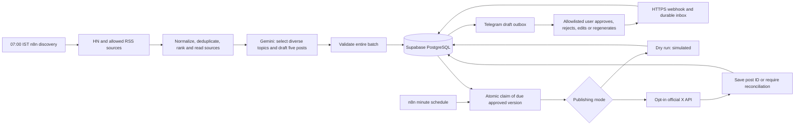

# X Content Agent

A self-hosted n8n system that researches topics, generates **one scheduled batch of five drafts per IST day plus five additional drafts per manual execution**, collects Telegram approval, and optionally publishes approved versions through the official X API. Manual drafts are unscheduled and cannot auto-publish. Gemini budgets and duplicate-content checks still apply.

**Live X publishing is OFF.** Dry-run is ON. Gemini also stays off until you configure and confirm an eligible free-tier API project/model. No paid service is enabled by installation. Read [cost boundaries](docs/COSTS.md) before provisioning accounts.

The agent and n8n have been started on an Oracle Ubuntu ARM64 VM, with a verified TLS connection to Supabase. **External integrations and end-to-end cloud acceptance are still incomplete; this is not a production-readiness certification.** See [verification results and deployment acceptance checks](docs/VERIFICATION.md). Free infrastructure cannot guarantee five successful drafts every day: if evidence, quotas or validation fail, the batch is withheld and an error is reported.

## Architecture

For a plain-language walkthrough of the complete flow and which parts could use native n8n blocks, read [How the system works](docs/FLOW.md).



Docker runs **n8n**, a small internal **Node.js service**, and **Caddy**. n8n owns scheduling, workflow orchestration, the Telegram webhook and emergency alerts. Native Schedule, HTTP Request, Webhook, Respond to Webhook, Execute Workflow, Error Trigger and Telegram nodes handle those tasks. One short Code node throttles emergency alerts.

The service keeps validation, OAuth signing, source fetch security and database state changes in ordinary, testable JavaScript. This avoids duplicating concurrency-sensitive logic across n8n Code nodes. Database access occurs inside the service through a restricted PostgreSQL function; n8n has no database administrator credential.

Supabase holds application data. n8n uses its **own persistent SQLite volume** for workflows, credentials and settings. Caddy exposes **only** the production Telegram webhook, with HTTPS. The n8n editor listens on VPS loopback and is accessed through SSH with n8n's owner authentication.

## Repository

```text
src/                  discovery, Gemini, validation, Telegram, X and HTTP service
config/               source list and personal writing style
supabase/migrations/  private schema, indexes, RLS and transactional commands
workflows/            five importable, inactive n8n workflow JSON files
deploy/               Caddy, Ubuntu installation, deployment and encrypted backup scripts
scripts/              workflow generation, structural checks and webhook registration
test/                 unit and PostgreSQL integration tests, local HTTP mock X
docs/                 costs, operations, security and verification
samples/              illustrative payloads, with no credentials
```

## 1. Local verification

Use Node.js 24.19.0 (or a compatible newer 24.x release) and npm:

```bash
npm ci --ignore-scripts
npm run verify
```

These commands install the locked dependencies, check workflow references, and run tests with embedded PostgreSQL (PGlite). They need no cloud account or API key. The end-to-end test sends a real HTTP request to a local mock X server, never to X. The mock transport is injected by the test; production has a fixed `https://api.x.com/2/tweets` endpoint.

To regenerate workflow JSON after editing its source:

```bash
npm run workflows
```

PGlite validates actual SQL and PL/pgSQL, but does not replace a Supabase concurrency/permissions check or a Docker/n8n import test. Do not treat a passing test suite as evidence of live API access.

## 2. Oracle account and Ubuntu VM

These steps require your own account and cannot be performed without your access:

1. Create an Oracle Free Tier account. Stay on the Free account; do not upgrade to paid to work around a capacity error.
2. In your **home region**, choose an Ubuntu 24.04 LTS image and an **Always Free eligible** Ampere A1 shape, if available. Start with **1 OCPU / 6 GB RAM** and a **50 GB boot volume**, only when the console confirms all resources are within your free allowance. Account-wide usage counts, including existing VMs/volumes. Avoid marketplace images, paid backups and paid networking resources.
3. Create an SSH key locally and upload only its public key. Keep the private key off the VM.
4. Configure the VCN/subnet with an internet gateway and a route for internet access. Assign the public address needed for your free-eligible configuration; verify its price in your console. No load balancer is needed.
5. In the network security group/security list, allow TCP **22 only from your current public IP**, and TCP **80/443 from the internet**. Never open 3000, 5432, or 5678. Keep existing Oracle platform rules unless you understand them.
6. Point an existing or free DNS hostname's A record to the VM. Remove an incorrect AAAA record unless IPv6 routing is configured. This repository does not purchase a domain.
7. SSH to the VM: `ssh -i /path/to/private-key ubuntu@VM_IP`.

Always Free capacity and idle-reclamation rules can interrupt availability; keep an encrypted off-VM backup. See [Oracle's current resource limits](https://docs.oracle.com/en-us/iaas/Content/FreeTier/freetier_topic-Always_Free_Resources.htm).

## 3. Upload and install Docker

Push this repository to your own GitHub repository when ready, or copy it to the VM. A direct copy avoids requiring a GitHub account:

```bash
# On your local computer, from the project directory:
git archive --format=tar -o x-agent.tar HEAD  # requires an initial commit first
scp -i /path/to/private-key x-agent.tar ubuntu@VM_IP:~/

# On the VM:
mkdir -p ~/x-content-agent
tar -xf ~/x-agent.tar -C ~/x-content-agent
cd ~/x-content-agent
sudo bash deploy/install-docker.sh
sudo usermod -aG docker "$USER"
```

The installer adds Docker's official Ubuntu repository, installs Docker Engine and the Compose plugin, enables Docker at boot, and sets the host timezone. Membership in `docker` grants effective root access; log out and reconnect after adding it. You can use `sudo docker ...` instead.

Alternatively, clone your repository into `~/x-content-agent`. The generated repository has no remote configured and has not been pushed.

## 4. Supabase Free database

Create one project in a **Free organization**. Confirm the estimated cost is zero. Keep the database password out of source control. No paid branch, dedicated IPv4 add-on, custom domain or PITR is needed.

Run `supabase/migrations/20261108205449_initial_agent.sql` once in the Supabase SQL Editor as the database owner, or with `psql`:

```bash
# ADMIN_DATABASE_URL is your trusted administrative connection, with TLS verify-full.
psql "$ADMIN_DATABASE_URL" -v ON_ERROR_STOP=1 -f supabase/migrations/20261108205449_initial_agent.sql
```

The migration creates the private `agent` schema and a **NOLOGIN** role `agent_runtime`. It is a versioned initial migration, not an idempotent setup script; don't rerun it over existing tables. Keep `agent` out of exposed Data API schemas. All tables have RLS, no public policies, and no runtime table grants.

Create a separate login with a newly generated password using the SQL Editor:

```sql
create role agent_login login password 'REPLACE_WITH_A_NEW_STRONG_PASSWORD'
  nosuperuser nocreatedb nocreaterole noinherit;
grant agent_runtime to agent_login;
-- This login needs inherited function permissions; no table privileges are granted.
alter role agent_login inherit;
grant connect on database postgres to agent_login;

update agent.automation_settings
set telegram_user_ids = array['YOUR_NUMERIC_TELEGRAM_USER_ID'],
    telegram_chat_id = 'YOUR_PRIVATE_CHAT_ID',
    publishing_enabled = false,
    gemini_daily_limit = 10;
```

The custom function is intentionally `SECURITY DEFINER` in a **private schema**, with a fixed search path and no dynamic SQL. It is executable only by `agent_runtime` and the migration owner. Runtime cannot directly change approvals, content versions or publishing state. These commands are a trusted backend boundary, not an API to expose to browsers.

Use the dashboard's direct connection if reachable, or **Supavisor session mode** for IPv4 connectivity. For a custom login, the pooler username normally includes the project suffix (for example `agent_login.PROJECT_REF`); use the configuration appropriate to your project's pooler. Do not use the service-role API key or the administrator database URL in the application. See [Supabase connection guidance](https://supabase.com/docs/guides/database/connecting-to-postgres) and [database roles](https://supabase.com/docs/guides/database/postgres/roles).

URL-encode special password characters. The application always verifies database TLS unless explicitly configured for a local test database. Do **not** add `sslmode` query parameters to its `DATABASE_URL`; node-postgres can let URL SSL options override explicit verification settings. If needed, download your project's CA into `secrets/db-ca.crt` and set `DATABASE_CA_FILE=/run/secrets/db-ca.crt`.

Download the certificate from **Database Settings → SSL configuration → Download certificate** in your project dashboard. The production certificate URL used by the [official dashboard source](https://github.com/supabase/supabase/blob/master/apps/studio/hooks/custom-content/custom-content.json) at deployment verification was:

```bash
mkdir -p secrets
curl --fail --location --proto '=https' \
  https://supabase-downloads.s3-ap-southeast-1.amazonaws.com/prod/ssl/prod-ca-2021.crt \
  -o secrets/db-ca.crt
openssl x509 -in secrets/db-ca.crt -noout -subject -dates
# Set DATABASE_CA_FILE=/run/secrets/db-ca.crt in .env, then recreate the agent.
docker compose up -d --build agent
docker compose exec agent node scripts/check-db.js
```

The check prints connection and publishing settings without exposing the database URL or password. Never fix a certificate error by disabling verification. For a new deployment, `deploy/init-env.py --project-ref YOUR_PROJECT_REF` can generate the initial `.env` and emit a SCRAM verifier for the dedicated database role. It refuses to overwrite an existing `.env`; replace `POOLER_HOST_PENDING` with the dashboard's session pooler hostname before starting services. The verifier is an authentication credential and should not be committed or shared publicly.

Verify with the runtime login:

```sql
select agent.command('settings', '{}');       -- succeeds
select * from agent.tweet_drafts;             -- must fail: permission denied
```

## 5. Telegram bot

1. In Telegram, create a bot using the official **@BotFather** `/newbot` flow. Save its token privately.
2. Send `/start` to your bot from the account that will approve drafts.
3. Before registering a webhook, inspect `getUpdates` from a trusted terminal to obtain `message.from.id` and `message.chat.id`. You may use a local script or Telegram's documented API. Do not paste bot tokens into chat or commit API output.
4. Set the private chat ID and allowlisted numeric sender ID in **both** `.env` and `agent.automation_settings`. The service and database each verify identity. Group chats are intentionally rejected.
5. Generate an independent webhook secret, at least 32 characters, using `openssl rand -hex 32`.

The bot receives drafts with buttons. **Edit** asks you to reply to one specific prompt; replies expire in one hour. A changed draft returns to `pending`. **Regenerate** clears approval before calling Gemini. If regeneration fails, approval stays cleared; monitoring releases an abandoned revision after one hour. Old-version or wrong-message buttons are rejected. Source links and editorial rationale are shown separately from tweet text.

Webhook registration happens only after n8n Workflow C is configured and active. Telegram allows one webhook per bot; use a separate bot for testing if an existing automation already uses it.

After verifying your numeric user ID and setting the database allowlist, the optional VPS helper `sudo python3 deploy/configure-telegram.py --user-id YOUR_ID` reads a mode-0600 `secrets/telegram-token.txt`, updates the service environment, imports an encrypted n8n bot credential, and binds the monitoring node to your private chat. It requires the monitoring workflow to be inactive, preserves its other settings, and does not activate workflows or register the webhook. Recreate the agent afterward to load the changed environment. Use the private editor to publish C and E when ready; leave generation and publishing workflows inactive until their acceptance checks pass.

## 6. Gemini and writing style

Create an API key in Google AI Studio for a project whose API billing is **not enabled**. Inspect the current [model pricing](https://ai.google.dev/gemini-api/docs/pricing) and your [active rate limits](https://ai.google.dev/gemini-api/docs/rate-limits). Select a model with a free `generateContent` tier and JSON structured-output support in your region/account. No default model name is assumed because eligibility changes.

Set `GEMINI_API_KEY`, `GEMINI_MODEL` and, only after that check, `GEMINI_FREE_TIER_CONFIRMED=true`. This confirmation is an operator assertion, not a billing API check. Do not enable paid grounding or fallbacks. Set the database's `gemini_daily_limit` to your chosen conservative cap.

Edit `config/style.json`: add 10–20 posts you wrote under `samples`. Until examples are supplied, the voice follows the written preferences; it is not a verified match to your personal style. Samples and source excerpts are sent to Gemini. Do not include private material that should not be processed under the free-tier terms.

The model selects five topics with at least four categories and a mix of two or three human topics and two or three technology topics. The validator checks JSON, topic membership, cited source membership, exact supporting excerpts, duplicate text and X weighted length (270 max, leaving margin below 280). Factuality, originality and voice still need your editorial approval; lexical checks cannot prove them.

## 7. Configure and deploy

```bash
cp .env.example .env
chmod 600 .env
mkdir -p secrets
openssl rand -hex 32  # generate N8N_ENCRYPTION_KEY
openssl rand -hex 32  # generate INTERNAL_API_TOKEN independently
openssl rand -hex 32  # generate TELEGRAM_WEBHOOK_SECRET independently
# Edit .env with your hostname, credentials, IDs and the three generated secrets.
bash deploy/deploy.sh
```

The deployment script validates Compose, builds the service, pulls pinned n8n/Caddy images, and starts the containers. It does not import or activate workflows, provision infrastructure or change billing. Preserve `N8N_ENCRYPTION_KEY` across redeployments: n8n needs it to decrypt saved credentials.

All services use `restart: unless-stopped`. Docker itself is enabled at boot. `docker compose down` removes containers but preserves named volumes; **never use `down -v`** on the production deployment. Service configuration changes in `.env` require `docker compose up -d --force-recreate agent` (and n8n if its own configuration changed).

Check status and recent logs:

```bash
docker compose ps
docker compose logs --tail=100 agent n8n caddy
```

The Compose file exposes n8n only at `127.0.0.1:5678`. Caddy permits only `POST /webhook/telegram-approval`; all editor/API/test-webhook paths return 404. See [security setup](docs/SECURITY.md) for network and host firewall verification.

## 8. Private n8n setup and workflow import

From your local computer, keep this tunnel running during setup:

```bash
ssh -i /path/to/private-key -N -L 5678:127.0.0.1:5678 ubuntu@VM_IP
```

Open `http://localhost:5678` and create the n8n owner account with a strong password. Use `localhost`, not the VPS public IP. Localhost is a browser-trusted loopback origin; if your browser rejects the secure cookie, use a browser that supports localhost secure cookies or arrange TLS for the private editor—do not expose the editor publicly as a workaround.

Import the five JSON files through n8n's **Import from File** menu, in order **E, B, A, C, D**. They are inactive. Alternatively, after owner setup, inspect `docker compose exec n8n n8n import:workflow --help` and use the supported CLI options for your instance; the import directory is mounted at `/import`.

After configuring credentials, publish B before executing A: n8n 2.46.6 requires a published sub-workflow for Execute Workflow. B has no independent schedule, so publishing B alone does not start daily generation. Keep A and D inactive until their acceptance checks pass.

Create and bind these credentials in n8n; workflow files contain names only, never fabricated credential IDs:

For a fresh instance with **no workflows**, after owner setup you can instead run `sudo python3 deploy/bootstrap-n8n.py` on the VM. This imports the five inactive workflows and binds the internal API and Telegram webhook header credentials directly from the server's `.env`. Temporary plaintext credential files are removed after import; n8n encrypts stored credentials. The script refuses existing workflows or a previous bootstrap marker. It does not configure the Telegram bot credential or activate anything. If interrupted, inspect n8n and `secrets/n8n-bootstrap.json` before manually completing setup.

| Credential | Type | Configuration |
|---|---|---|
| Agent internal API | Header Auth | Name `X-Agent-Token`; value equal to `INTERNAL_API_TOKEN`. Assign to every HTTP Request node. |
| Telegram webhook secret | Header Auth | Name `X-Telegram-Bot-Api-Secret-Token`; value equal to `TELEGRAM_WEBHOOK_SECRET`. Assign only to Workflow C's Webhook node. |
| Telegram bot | Telegram API | Your bot token. Assign to Workflow E's emergency Telegram node and replace its chat ID placeholder. |

In Workflow A's Execute Workflow node, select the imported **B** workflow. In A–D's workflow settings, select **E** as the Error Workflow. Imports can remap workflow IDs, so verify these links even though the JSON supplies stable local IDs. Confirm timezone `Asia/Kolkata` in every workflow. Do not enable Retry On Fail on publishing HTTP nodes.

Activate E, C and D for a dry run. B is invoked as a sub-workflow and can be run manually. Run A manually to test discovery and generation, then activate A's daily schedule once the acceptance checks pass. Some n8n versions call this action **Publish** rather than Activate; use the deployed version's active/published state. Re-importing files should be treated as an update, not a way to create competing active schedulers.

Register the webhook from the VPS:

```bash
docker compose exec agent node scripts/telegram-webhook.js
```

The script reads the container environment, sets the public HTTPS webhook, limits allowed updates, and preserves pending updates. A webhook response is acknowledged only after the authorized payload has been durably inserted. Approval processing can then recover independently through Workflow E.

## 9. Publishing policy and optional X setup

Schedules are **10:00, 13:00, 16:00, 19:00 and 22:00 IST**. Approve **before** the scheduled time. The publisher allows up to five minutes for scheduler jitter after a slot, but not late approval. Late approvals are skipped; old queued drafts expire when the publisher resumes. There is no automatic catch-up or rescheduling.

With `DRY_RUN=true`, an approved due draft becomes **simulated**, gets no real X ID, and cannot later be automatically posted live. Use a separate test project/database for dry runs. With `DRY_RUN=false` and X disabled, approved drafts stay queued and a daily notice explains why publishing is unavailable.

For normal zero-cost drafting after your test period, set **`DRY_RUN=false` while keeping every X publishing/cost switch false**. This preserves approved drafts for manual posting instead of consuming them as simulations.

**Stop here if you do not approve X API charges.** Drafting and Telegram approval remain usable without X access.

If you later explicitly choose paid official API access:

1. Review your X developer account's current price and access limits. Disable auto-recharge and choose a spending limit in the provider console if available. This repository cannot enforce a dollar billing cap.
2. Create an application with user-context **Read and Write** permission. Obtain its consumer/API key and secret, plus your own user access token and secret. Regenerate user tokens after changing permissions if required. This implementation uses **OAuth 1.0a user context**, not an application-only bearer token. See [X authorization](https://docs.x.com/fundamentals/authentication/oauth-1-0a/authorizing-a-request).
3. Set the four `X_*` credentials, `X_COST_APPROVED=true`, `PUBLISHING_ENABLED=true`, and `DRY_RUN=false` in `.env`.
4. Set `agent.automation_settings.publishing_enabled=true` as the database owner, and recreate the agent container.
5. Generate fresh drafts and approve each desired version. Previously simulated/failed/uncertain drafts are never silently promoted into new posting attempts.

There are **no automatic retries of X creation requests**. A 429/401/403 is a terminal failure requiring review. A timeout, malformed success, 5xx or process crash after claim becomes `uncertain`, reserves daily capacity, and needs [manual reconciliation](docs/OPERATIONS.md). A returned X ID is saved before a Telegram success notification is delivered.

## 10. Operations and next checks

Read [operations and recovery](docs/OPERATIONS.md) for pausing, safe reruns, stuck jobs, backups and restoration. Run the [deployment acceptance checklist](docs/VERIFICATION.md) before considering live publishing. Monthly costs and usage boundaries are in [COSTS.md](docs/COSTS.md).

The initial repository needs your account setup, VM, DNS, Supabase project, Telegram bot, Gemini key/model, n8n credential bindings and style samples. X credentials and charges are optional. No cloud deployment, GitHub push, live post or live API verification has been performed as part of repository creation.
